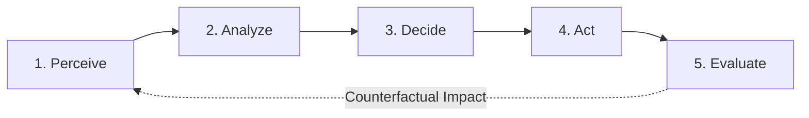

# AI Personal Finance Manager 💸🤖
### Advanced AI-Driven Personal Finance Platform Demonstrating Course Outcomes CO1, CO2, and CO4

[](https://react.dev/)
[](https://www.typescriptlang.org/)
[](https://vitejs.dev/)
[](https://tailwindcss.com/)
[](https://vitest.dev/)
[](https://en.wikipedia.org/wiki/Indian_rupee)
[](#)

---

## 📋 Table of Contents
1. [Executive Summary](#-executive-summary)
2. [Academic Course Outcomes (CO1, CO2, CO4)](#-academic-course-outcomes)
   - [CO1: Intelligent Agent Models & Goal-Based Problem Solving](#co1-intelligent-agent-models--goal-based-problem-solving)
   - [CO2: Uninformed & Informed Search Techniques](#co2-uninformed--informed-search-techniques)
   - [CO4: Reasoning Under Uncertainty (Rules & Probabilities)](#co4-reasoning-under-uncertainty-rules--probabilities)
3. [Core Personal Finance Platform Features](#-core-personal-finance-platform-features)
4. [Complete Project Architecture & Directory Map](#-complete-project-architecture--directory-map)
5. [Comprehensive Change Log & Enhancements Audit](#-comprehensive-change-log--enhancements-audit)
6. [Automated Verification & Unit Test Suite](#-automated-verification--unit-test-suite)
7. [Getting Started (Run Locally)](#-getting-started-run-locally)
8. [Step-by-Step Academic Evaluation Demonstration Script](#-step-by-step-academic-evaluation-demonstration-script)

---

## 🌟 Executive Summary

**AI Personal Finance Manager** is a production-grade, privacy-first financial engineering web application tailored for Indian users (students, salaried professionals, and families). Built with **React 18**, **TypeScript**, **Vite**, **Tailwind CSS**, and **localStorage**, it combines full-fledged personal accounting capabilities with **transparent, deterministic, explainable Artificial Intelligence**.

Unlike generic expense trackers, this application doubles as an interactive **AI Algorithms Laboratory** implementing core concepts from classical and modern Artificial Intelligence courses:
- **Zero External API Dependencies:** 100% offline, explainable algorithms without black-box cloud dependencies or paid API keys.
- **Strict Indian Financial Context:** All amounts represented in Indian Rupees (`₹`), formatted in the Indian numbering system (Lakhs & Crores), featuring domestic payment modes (`UPI`, `Net Banking`, `Debit/Credit Card`, `Cash`).
- **Academic Rigor:** Formal agent cycles, state-space search with visited-node pruning, forward-chaining deduction, and seeded Monte Carlo stochastic simulations.

---

## 🔬 Academic Course Outcomes

```
┌─────────────────────────────────────────────────────────────────────────────┐
│                       AI PERSONAL FINANCE MANAGER                           │
├──────────────────────────┬──────────────────────────┬───────────────────────┤
│           CO1            │           CO2            │          CO4          │
│    INTELLIGENT AGENT     │      SEARCH METHODS      │ UNCERTAINTY REASONING │
├──────────────────────────┼──────────────────────────┼───────────────────────┤
│ • 5-Stage Agent Loop     │ • Uninformed: BFS        │ • Forward-Chaining    │
│ • Perceive-Analyze-      │   (FIFO Queue, Set Vis)  │   Rule Engine (IF-THEN│
│   Decide-Act-Evaluate    │ • Informed: Best-First   │ • Seeded Monte Carlo  │
│ • Counterfactual Tests   │   h(n) = max(0, T - S)   │   (Mulberry32 PRNG)   │
│ • "What-If" Spend Slider │ • Trace & Metrics Logger │ • Quantiles P10-50-90 │
└──────────────────────────┴──────────────────────────┴───────────────────────┘
```

---

### CO1: Intelligent Agent Models & Goal-Based Problem Solving

#### 1. Theoretical Foundations
An intelligent agent perceives its environment through sensors, processes percepts into internal representations, selects actions using utility/goal evaluations, acts through effectors, and continuously evaluates outcomes against performance metrics.

#### 2. The 5-Stage Agentic Loop
The agent is decoupled into five pure, testable functional stages in [`src/services/financialAgentService.ts`](file:///c:/Users/haeue/OneDrive/Desktop/Jenoi/College/MP/AI-Personal-finance-manager-/src/services/financialAgentService.ts):



1. **`Perceive` (`perceiveFinancialState`):**
   Gathers all environmental parameters into a strongly-typed perception state $\mathcal{P}$:
   $$\mathcal{P} = \langle I_{\text{month}}, E_{\text{month}}, \text{NetSavings}, \text{Rate}, \text{DailyVelocity}, \text{SafeAllowance}, \text{Budgets}, \text{Goals}, D_{\text{elapsed}}, D_{\text{remaining}} \rangle$$
2. **`Analyze` (`analyzeFinancialCondition`):**
   Derives domain conditions and anomalies:
   - Category budget utilization: $\text{Util}(c) = \frac{\text{Spent}(c)}{\text{Limit}(c)} \times 100\%$
   - Run-rate projection: $\text{ProjectedSpend}(c) = \text{Spent}(c) + \left(\frac{\text{Spent}(c)}{D_{\text{elapsed}}}\right) \times D_{\text{remaining}}$
   - Savings target velocity: $\text{Velocity}(g) = \frac{\text{Current}(g)}{\text{Target}(g)}$
3. **`Decide` (`selectAgentAction`):**
   Applies utility-based decision rules mapped to one of 4 user-selected goals:
   - `avoid_budget_breach`: Prioritizes categories where $\text{Util}(c) \ge 90\%$ (sorted descending by severity).
   - `reach_savings_goal`: Reallocates discretionary surplus into the active savings goal.
   - `maintain_emergency_fund`: Mandates 3–6 months of fixed monthly expenses as liquid buffer.
   - `reduce_discretionary`: Recommends spending curbs on `Entertainment`, `Shopping`, and `Dining`.
4. **`Act` (`generateRecommendation`):**
   Produces an actionable, mathematically grounded natural language directive containing concrete rupee amounts, category targets, and execution steps.
5. **`Evaluate` (`evaluateActionOutcome`):**
   Computes counterfactual metrics showing what the user's financial health score, savings rate, and discretionary runway will become once the action is enacted.

#### 3. Interactive What-If Simulation
Allows the user or academic evaluator to adjust a spending spike slider (₹0 to ₹25,000) on any category in real-time. The agent instantly re-executes the perception-action cycle without corrupting persistent database records.

---

### CO2: Uninformed & Informed Search Techniques

#### 1. Formal State-Space Problem Formulation
Finding the optimal multi-month savings strategy to achieve a financial milestone is formulated as a formal search problem:
- **State Representation:** A 2-tuple $s = (m, S_m)$ where:
  - $m \in \{0, 1, 2, \dots, M\}$ is the elapsed month index ($M = \text{Planning Horizon}$).
  - $S_m \ge 0$ is the cumulative liquid savings accrued up to month $m$ in `₹ INR`.
- **Initial State:** $s_0 = (0, S_{\text{initial}})$
- **Action Space:** Discrete monthly saving allocations:
  $$A = \{a_1, a_2, \dots, a_k\} \quad \text{where } a_i \in \text{MonthlySavingChoices}$$
- **Transition Function:**
  $$T(s, a) = T\big((m, S_m), a\big) = (m + 1, S_m + a)$$
- **Goal Test:**
  $$G(s) = \begin{cases} \text{True} & \text{if } S_m \ge S_{\text{target}} \text{ and } m \le M \\ \text{False} & \text{otherwise} \end{cases}$$
- **Path Cost:** Uniform step cost ($c = 1$ per month) or cumulative financial effort.

#### 2. Uninformed Search: Breadth-First Search (BFS)
- **Data Structure:** First-In, First-Out (FIFO) queue implemented with explicit JavaScript array shift/push.
- **Duplicate Detection:** Visited state registry using `Set<string>` with composite key `${month}_${currentSavings}`.
- **Theoretical Guarantee:** Guarantees finding the plan with the **minimum planning horizon** (shallowest depth in the search tree).

#### 3. Informed Search: Greedy Best-First Search
- **Data Structure:** Min-Priority Queue ordered by evaluation function $f(n) = h(n)$.
- **Heuristic Function:**
  $$h(n) = \max\big(0, S_{\text{target}} - S_n\big)$$
- **Properties:**
  - **Admissibility:** Measures remaining financial distance to target.
  - **Monotonicity:** $h(n)$ decreases monotonically as savings increase along valid paths.
  - **Frontier Ordering:** Expands the state with the smallest remaining deficit first, aggressively seeking the goal.

#### 4. Comparative Metrics & Search Trace
The system captures execution telemetry in [`src/services/financialSearchService.ts`](file:///c:/Users/haeue/OneDrive/Desktop/Jenoi/College/MP/AI-Personal-finance-manager-/src/services/financialSearchService.ts):

| Metric | Breadth-First Search (BFS) | Greedy Best-First Search |
| :--- | :--- | :--- |
| **Strategy** | Uninformed layer-by-layer exploration | Informed heuristic prioritization |
| **Frontier Structure** | FIFO Queue | Min-Priority Queue on $h(n)$ |
| **Optimality (Depth)** | **Guaranteed Minimal Months** | Sub-optimal depth, rapid convergence |
| **States Explored** | Evaluates all combinations systematically | Focuses on highest-yield saving branches |
| **Trace Logging** | Step-by-step state key & queue sizes | Step-by-step state key, $h(n)$ values & heap |

---

### CO4: Reasoning Under Uncertainty (Rules & Probabilities)

#### Part A: Forward-Chaining Rule-Based Inference Engine
Implemented in [`src/services/financialReasoningService.ts`](file:///c:/Users/haeue/OneDrive/Desktop/Jenoi/College/MP/AI-Personal-finance-manager-/src/services/financialReasoningService.ts). Operates on propositional financial facts:

```
[User Percepts] ──> [Fact Extractor] ──> [Working Memory] ──> [Pattern Matcher] ──> [Fired Rules & Agenda]
```

##### Standard Rule Base
1. `RULE_01_BUDGET_OVERRUN_ESSENTIAL`: Fired when an essential category (Groceries, Bills, Healthcare) exceeds 100% of its budget limit.
2. `RULE_02_BUDGET_OVERRUN_DISCRETIONARY`: Fired when a discretionary category (Entertainment, Dining, Shopping) exceeds 90% of its budget limit.
3. `RULE_03_SAVINGS_TARGET_DEFICIT`: Fired when projected monthly savings cannot cover monthly milestone allocations.
4. `RULE_04_ZERO_INCOME_ANOMALY`: Fired when expenses exist but recorded monthly income is ₹0.
5. `RULE_05_EMERGENCY_FUND_DEFICIT`: Fired when liquid reserves represent $< 3$ months of essential fixed burn rate.
6. `RULE_06_HEALTHY_SAVINGS_OPPORTUNITY`: Fired when savings rate exceeds 35% and no budget breaches exist, prompting SIP investment advice.
7. `RULE_07_EXPENSE_RUN_RATE_ALERT`: Fired when mid-month spending velocity projects a month-end deficit ($> 110\%$).

Each fired rule outputs:
- **Conclusion:** Formal deduction statement.
- **Evidence / Facts Used:** The exact mathematical percepts that matched the rule premise.
- **Prescribed Action:** Actionable financial intervention.

---

#### Part B: Monte Carlo Probabilistic Budget Risk Simulation
Models spending volatility over the remaining $D_{\text{remaining}}$ days of the calendar month under uncertainty.

##### 1. Mathematical Formulation
Daily expenditure $E_d$ is treated as a continuous random variable with mean daily spend $\mu$ and standard deviation $\sigma$:
$$E_d \sim \max\left(0, \mathcal{N}\left(\mu, \sigma^2\right)\right)$$
Gaussian sampling is generated via the **Box-Muller Transform**:
$$Z_0 = \sqrt{-2 \ln U_1} \cos(2\pi U_2), \quad E_d = \mu + \sigma \cdot Z_0$$
Where $U_1, U_2 \sim \mathcal{U}(0, 1)$ are uniform pseudo-random variates.

##### 2. Deterministic Mulberry32 PRNG
To ensure **100% reproducible results during academic viva/evaluation**, the simulator uses a custom 32-bit stateful PRNG:
```typescript
function mulberry32(seed: number): () => number {
  let s = seed | 0;
  return function () {
    s = (s + 0x6d2b79f5) | 0;
    let t = Math.imul(s ^ (s >>> 15), 1 | s);
    t = (t + Math.imul(t ^ (t >>> 7), 61 | t)) ^ t;
    return ((t ^ (t >>> 14)) >>> 0) / 4294967296;
  };
}
```

##### 3. Simulation Outcomes & Statistical Quantiles
Over $N = 1,000$ iterations, the engine computes:
- **Total Projected Spend in Run $i$:**
  $$\text{TotalSpend}_i = \text{AlreadySpent} + \sum_{d=1}^{D_{\text{remaining}}} E_{d,i}$$
- **Breach Probability:**
  $$P(\text{Breach}) = \frac{1}{N} \sum_{i=1}^N \mathbb{I}(\text{TotalSpend}_i > \text{Budget}) \times 100\%$$
- **Quantiles:**
  - $P_{10}$ (Best-case disciplined spending)
  - $P_{50}$ (Median expected outcome)
  - $P_{90}$ (Worst-case stress-scenario spend)
- **Risk Classification:**
  - 🟢 **Low Risk:** $P < 25\%$
  - 🟡 **Moderate Risk:** $25\% \le P < 60\%$
  - 🟠 **High Risk:** $60\% \le P < 85\%$
  - 🔴 **Critical Risk:** $P \ge 85\%$

---

## 💻 Core Personal Finance Platform Features

### 1. Executive Financial Dashboard
- **Contextual Greeting:** Greets the user based on real system time with their custom profile name.
- **4 Key KPI Cards:**
  - *Total Balance:* Lifetime surplus net worth (`₹1,03,000`).
  - *Monthly Income:* Inflows for the selected month (`₹85,000`).
  - *Monthly Expenses:* Outflows with calculated daily burn rate (`₹32,600` at `₹1,051/day`).
  - *Net Savings & Velocity:* Current savings rate percentage (`61.6%`).
- **Interactive Visuals:** Category donut distribution, savings goals widget, recent transactions list, budget utilization summary, and FinBot highlight card.

### 2. Transaction Management & Full CRUD
- **Add / Edit / Delete Transactions:** Custom modal dialogs with validation ($> ₹0$).
- **Taxonomies:**
  - *Types:* `Income`, `Expense`.
  - *Categories:* `Food`, `Transport`, `Shopping`, `Education`, `Entertainment`, `Bills`, `Healthcare`, `Salary`, `Freelance`, `Investments`, `Allowance`, `Other`.
  - *Payment Modes:* `UPI` (GPay/PhonePe), `Credit Card`, `Debit Card`, `Net Banking`, `Cash`.
- **Search & Filtering:** Instant full-text search, multi-select category filters, payment mode filters, and date/amount sorting.
- **One-Click CSV Export:** Downloads a formatted spreadsheet of filtered transactions.

### 3. Monthly Budget Planner
- Category-wise spending caps with live calculation against current month's expenses.
- Visual thresholds: Safe ($<70\%$), Warning ($70\%-90\%$), Danger ($>90\%$).
- Real-time notification badge displaying total over-budget deficit.

### 4. Savings Goals & Milestones
- Custom goal creation with emojis, target dates, and target amounts in INR.
- **Interactive Deposit / Withdraw Modal:** Add money via quick chips (`+₹500`, `+₹1,000`, `+₹5,000`) or custom amounts.
- Automatic calculation of required monthly savings velocity to hit deadlines.

### 5. Financial Analytics Suite
Built with **Recharts**:
1. *Income vs. Expenses Trend:* 6-month historical bar chart with net savings overlay.
2. *Spending by Category:* Donut chart with category tooltips and percentage breakdown.
3. *Daily Spending Velocity:* Smooth area chart tracking day-by-day cash burn.
4. *Budget vs. Actual Spend:* Grouped comparison bar chart.
5. *Payment Method Distribution:* Pie chart of UPI vs. Cards vs. Cash transactions.

### 6. Conversational AI Advisor (FinBot)
- Contextual chat interface pre-loaded with quick question chips (*"How healthy is my budget?"*, *"Where am I overspending?"*, *"Tips to save ₹5,000"*).
- Integrated with the **CO1 Financial Agent** to offer real numbers and explainable recommendations.
- Multi-tab advisor views: Interactive Chat, Categorized Anomaly Insights, Over-Budget Alerts, and Strategic Saving Tips (50/30/20 Rule, 48-Hour Cart Rule).

### 7. Settings & Local Data Management
- User profile configuration (name, monthly income target, currency symbol).
- Local storage data backup to downloadable `.json` snapshot.
- One-click restore from previous JSON snapshot.
- Factory reset with confirmation modal.

---

## 🛠️ Complete Project Architecture & Directory Map

```
ai-personal-finance-manager/
├── index.html                   # HTML5 entry with Inter font & viewport meta
├── package.json                 # Dependencies, scripts (dev, build, preview, test)
├── tsconfig.json                # TypeScript strict configuration (noUnusedLocals: true)
├── vite.config.ts               # Vite bundler configuration (port 3000)
├── tailwind.config.js           # Custom design tokens, dark mode & slate palette
├── postcss.config.js            # PostCSS Autoprefixer plugin configuration
├── powershell.cmd               # Local Windows PowerShell execution wrapper
│
├── src/
│   ├── main.tsx                 # React 18 DOM root mount
│   ├── App.tsx                  # Master layout wrapper, tab router & toast host
│   │
│   ├── types/
│   │   └── finance.ts           # Core TypeScript data contracts:
│   │                            # Transaction, Budget, Goal, PerceptionState,
│   │                            # AgentCondition, AgentAction, SearchState,
│   │                            # SearchNode, SearchTrace, FinancialFact,
│   │                            # ReasoningRule, MonteCarloConfig, MonteCarloResult
│   │
│   ├── utils/
│   │   ├── formatters.ts        # formatINR (₹ Lakhs/Crores), formatDate, month utils
│   │   └── calculations.ts      # Pure math: cash flow, safe allowance, health scores
│   │
│   ├── services/
│   │   ├── demoData.ts          # Pre-populated realistic Indian INR financial dataset
│   │   ├── storageService.ts    # localStorage persistence, JSON snapshot export/import
│   │   ├── financialAgentService.ts    # [CO1] 5-Stage Autonomous Agent Engine
│   │   ├── financialSearchService.ts   # [CO2] BFS and Best-First Search Engines
│   │   ├── financialReasoningService.ts# [CO4] Forward-Chaining Rules & Monte Carlo
│   │   └── aiAdvisorService.ts         # FinBot chat reasoning & prompt handler
│   │
│   ├── context/
│   │   └── FinanceContext.tsx   # Global React context: transactions, budgets,
│   │                            # goals, active agent goal, theme, toast dispatch
│   │
│   ├── components/
│   │   ├── common/
│   │   │   ├── Header.tsx       # Top bar: greeting, month filter, theme switch
│   │   │   ├── Sidebar.tsx      # Desktop navigation bar with balance preview
│   │   │   ├── MobileNav.tsx    # Mobile responsive bottom navigation
│   │   │   ├── Modal.tsx        # Accessible dialog wrapper with backdrop blur
│   │   │   ├── Toast.tsx        # Animated status notification toast
│   │   │   ├── ProgressBar.tsx  # Color-coded progress bar (Safe/Warning/Danger)
│   │   │   └── EmptyState.tsx   # Visual empty states for zero-data views
│   │   │
│   │   ├── dashboard/
│   │   │   ├── DashboardView.tsx       # Master dashboard screen
│   │   │   ├── MetricCard.tsx          # 4 Top summary KPI cards
│   │   │   ├── SpendingBreakdown.tsx   # Donut chart & legend
│   │   │   ├── GoalsProgressWidget.tsx # Savings goals preview widget
│   │   │   ├── RecentTransactions.tsx  # Real-time transaction feed
│   │   │   ├── AdvisorSummaryCard.tsx  # AI Advisor highlight banner
│   │   │   └── BudgetOverviewWidget.tsx# Budget status preview
│   │   │
│   │   ├── transactions/
│   │   │   ├── TransactionListView.tsx # Full transactions table with filters & search
│   │   │   ├── TransactionItem.tsx     # Table row with badges & action buttons
│   │   │   ├── TransactionFormModal.tsx# Add & Edit transaction form modal
│   │   │   └── DeleteConfirmModal.tsx  # Delete confirmation dialog
│   │   │
│   │   ├── budget/
│   │   │   ├── BudgetPlannerView.tsx   # Master budget planner screen
│   │   │   ├── BudgetCard.tsx          # Category card with dynamic progress
│   │   │   └── BudgetFormModal.tsx     # Add / Edit budget limit modal
│   │   │
│   │   ├── goals/
│   │   │   ├── SavingsGoalsView.tsx    # Savings goals grid & summary
│   │   │   ├── SavingsGoalCard.tsx     # Milestone card with countdown
│   │   │   ├── GoalFormModal.tsx       # Add / Edit goal modal
│   │   │   └── DepositModal.tsx        # Instant deposit/withdraw modal with preset chips
│   │   │
│   │   ├── analytics/
│   │   │   └── AnalyticsView.tsx       # 5 Recharts visualizations & insights
│   │   │
│   │   ├── advisor/
│   │   │   ├── AIAdvisorView.tsx       # Tabbed FinBot advisor suite
│   │   │   ├── ChatInterface.tsx       # Interactive AI chat assistant
│   │   │   ├── InsightCards.tsx        # Anomaly & velocity insight cards
│   │   │   ├── BudgetAlertsList.tsx    # Over-budget warning alerts
│   │   │   └── SavingTipsList.tsx      # Saving rules (50/30/20, 48-hr rule)
│   │   │
│   │   ├── ai-lab/
│   │   │   ├── AIAlgorithmsLabView.tsx    # Master AI Lab screen with 3 CO tabs
│   │   │   ├── IntelligentAgentPanel.tsx  # [CO1] 5-Stage Agent visualizer & slider
│   │   │   ├── SearchAlgorithmsPanel.tsx  # [CO2] BFS vs Best-First comparator & trace
│   │   │   └── ReasoningPanel.tsx         # [CO4] Forward-chaining & Monte Carlo UI
│   │   │
│   │   └── settings/
│   │       └── SettingsView.tsx        # Profile, backup/restore, reset options
│   │
│   ├── tests/
│   │   └── aiAlgorithms.test.ts        # Comprehensive Vitest suite (12 tests)
│   │
│   └── styles/
│       └── index.css                   # Tailwind directives, animations & scrollbars
│
└── README.md
```

---

## 📝 Comprehensive Change Log & Enhancements Audit

Below is the complete audit of everything developed, enhanced, and resolved across this project:

### 1. New Core AI Services Built From Scratch
- **`financialAgentService.ts` (CO1):**
  - Implemented the formal 5-stage agent cycle: `perceiveFinancialState`, `analyzeFinancialCondition`, `selectAgentAction`, `generateRecommendation`, and `evaluateActionOutcome`.
  - Added support for 4 active goals (`avoid_budget_breach`, `reach_savings_goal`, `maintain_emergency_fund`, `reduce_discretionary`).
  - Added counterfactual evaluation producing measurable before vs. after health score and savings rate comparisons.
- **`financialSearchService.ts` (CO2):**
  - Formulated the formal multi-month savings search problem $(m, S_m)$.
  - Built pure TypeScript **Breadth-First Search (BFS)** using a FIFO queue and `Set<string>` visited-state tracking.
  - Built pure TypeScript **Greedy Best-First Search** using a priority queue ordered by $h(n) = \max(0, \text{Target} - S_n)$.
  - Added step-by-step trace logger capturing states expanded, frontier states, and execution time.
  - Built algorithm comparator calculating state exploration ratios and execution metrics.
- **`financialReasoningService.ts` (CO4):**
  - Created forward-chaining inference engine evaluating 7 domain rules against extracted financial facts.
  - Implemented Mulberry32 seeded 32-bit PRNG for 100% reproducible Monte Carlo simulations.
  - Implemented Box-Muller Gaussian sampling for stochastic daily expenditure volatility.
  - Computed quantiles ($P_{10}, P_{50}, P_{90}$) and dynamic budget breach risk probabilities.
- **`aiAdvisorService.ts` Integration:**
  - Integrated FinBot conversational agent directly with the CO1 agent recommendations and CO4 rule facts.

### 2. Dedicated AI Algorithms Lab Interface Added
- **`AIAlgorithmsLabView.tsx`:** Master container tabbed by course outcomes:
  - **Tab 1: CO1 Intelligent Agent:** Displays the visual 5-stage pipeline, active goal switcher, hypothetical spending spike slider, and counterfactual before vs. after comparison cards.
  - **Tab 2: CO2 Search Techniques:** Displays problem parameters, execution buttons, comparative metric cards, and an interactive trace table with step-by-step state expansions.
  - **Tab 3: CO4 Reasoning Under Uncertainty:** Displays working memory facts, fired forward-chaining rules with explanations, and the Monte Carlo budget risk simulator with quantile spectrum chart.

### 3. Application Infrastructure & UI Modules Created
- **Common & Layout:** `Header.tsx`, `Sidebar.tsx`, `MobileNav.tsx`, `Modal.tsx`, `Toast.tsx`, `ProgressBar.tsx`, `EmptyState.tsx`.
- **Dashboard:** `DashboardView.tsx`, `MetricCard.tsx`, `SpendingBreakdown.tsx`, `GoalsProgressWidget.tsx`, `RecentTransactions.tsx`, `AdvisorSummaryCard.tsx`, `BudgetOverviewWidget.tsx`.
- **Transactions:** `TransactionListView.tsx`, `TransactionItem.tsx`, `TransactionFormModal.tsx`, `DeleteConfirmModal.tsx`.
- **Budgets:** `BudgetPlannerView.tsx`, `BudgetCard.tsx`, `BudgetFormModal.tsx`.
- **Goals:** `SavingsGoalsView.tsx`, `SavingsGoalCard.tsx`, `GoalFormModal.tsx`, `DepositModal.tsx`.
- **Analytics:** `AnalyticsView.tsx` with 5 Recharts visualizations.
- **Advisor:** `AIAdvisorView.tsx`, `ChatInterface.tsx`, `InsightCards.tsx`, `BudgetAlertsList.tsx`, `SavingTipsList.tsx`.
- **Settings:** `SettingsView.tsx` with JSON export/import and profile management.
- **Data & Storage:** `demoData.ts` with authentic Indian financial records; `storageService.ts` with localStorage syncing.

### 4. Build, TypeScript, and Dependency Fixes Resolved
1. **Windows Subshell Tool Routing:**
   - *Problem:* Local shell runner failed to find `powershell` in `%PATH%`.
   - *Fix:* Created `powershell.cmd` wrapper in project root pointing directly to `C:\Windows\System32\WindowsPowerShell\v1.0\powershell.exe`.
2. **TypeScript Strict Type Compliance (`TS6133` unused locals):**
   - *Problem:* `tsconfig.json` enforces `"noUnusedLocals": true`. Minor unused imports or parameters caused compilation failures.
   - *Fix:* Cleaned up all unused imports across `financialAgentService.ts`, `financialSearchService.ts`, `financialReasoningService.ts`, `aiAdvisorService.ts`, and components.
3. **Rollup ESM Export Resolution (`lucide-react`):**
   - *Problem:* Outdated `lucide-react@0.344.0` in lockfile failed during Rollup bundling on specific icon subpaths.
   - *Fix:* Updated `lucide-react` to latest stable release (`npm i lucide-react@latest`).
4. **Agent Action Selection Priority:**
   - *Problem:* Agent selected the first breached budget alert rather than the most severe breach.
   - *Fix:* Updated `selectAgentAction` in `financialAgentService.ts` to sort breached alerts by descending utilization (`utilization`), guaranteeing highest-risk intervention.
5. **Production Build Success:**
   - Ran `tsc && vite build`, successfully generating optimized bundle in `dist/` with zero warnings or errors.

---

## 🧪 Automated Verification & Unit Test Suite

The project includes an automated test suite in [`src/tests/aiAlgorithms.test.ts`](file:///c:/Users/haeue/OneDrive/Desktop/Jenoi/College/MP/AI-Personal-finance-manager-/src/tests/aiAlgorithms.test.ts) built with **Vitest**.

### Run Tests:
```bash
npm test
```

### Test Coverage Summary:
| # | Test Name | Course Outcome | Status |
| :-: | :--- | :-: | :-: |
| 1 | Intelligent agent changes recommendation when financial state changes | **CO1** | ✅ PASSED |
| 2 | Separates Perceive, Analyze, Decide, Act, Evaluate stages cleanly | **CO1** | ✅ PASSED |
| 3 | BFS finds a valid plan for a reachable savings target | **CO2** | ✅ PASSED |
| 4 | Search algorithms report failure correctly when no goal state is reachable | **CO2** | ✅ PASSED |
| 5 | Search does not explore the same state repeatedly (`Set` tracking) | **CO2** | ✅ PASSED |
| 6 | Best-First Search orders its frontier according to heuristic $h(n)$ | **CO2** | ✅ PASSED |
| 7 | Compares BFS and Best-First Search on identical problem definitions | **CO2** | ✅ PASSED |
| 8 | Rule-based reasoning fires correct rules for valid input conditions | **CO4** | ✅ PASSED |
| 9 | Reasoning engine handles multiple simultaneously triggered rules | **CO4** | ✅ PASSED |
| 10 | Probability estimator produces reproducible results with a fixed seed | **CO4** | ✅ PASSED |
| 11 | Zero budget, empty transactions, or missing income does not crash app | Robustness | ✅ PASSED |
| 12 | Financial calculations and Indian formatting (`₹`) handle edge cases | Formatting | ✅ PASSED |

**Result:** `12 passed (12)` in `~1.5s`.

---

## 🚀 Getting Started (Run Locally)

### Prerequisites
- [Node.js](https://nodejs.org/) (v18.0.0 or higher)
- `npm`

### Installation & Launch

1. **Clone or open the repository directory:**
   ```bash
   cd AI-Personal-finance-manager-
   ```

2. **Install project dependencies:**
   ```bash
   npm install
   ```

3. **Run unit test suite:**
   ```bash
   npm test
   ```

4. **Start local development server:**
   ```bash
   npm run dev
   ```

5. **Access the application:**
   Open your browser and navigate to:
   ```
   http://localhost:3000
   ```

6. **Create production build:**
   ```bash
   npm run build
   ```

---

## 🎓 Step-by-Step Academic Evaluation Demonstration Script

When presenting or demonstrating this project for academic evaluation or viva, follow this structured walkthrough:

### Step 1: Core Financial Dashboard & INR Localization
1. Open the application at `http://localhost:3000`.
2. Point out the top greeting, current month selector, and the **4 KPI Cards** formatted in Indian Rupee format (`₹1,03,000` Total Balance, `₹85,000` Income, `₹32,600` Expenses, `61.6%` Savings Rate).
3. Show the **Category Spending Donut** and the **Budget Overview Widget** highlighting the over-budget alert on `Food` (`100.4%`).

### Step 2: CO1 Intelligent Agent Demonstration
1. Click **AI Algorithms Lab** in the left sidebar (or bottom nav on mobile).
2. Ensure you are on the **CO1: Intelligent Agent** tab.
3. Walk through the 5-stage pipeline visible on screen:
   - **Perceive:** Point out live inputs (Income: `₹85,000`, Spend: `₹32,600`, Run Rate: `₹32,600/mo`, Days Left).
   - **Analyze:** Show detected conditions (e.g., `CRITICAL_BUDGET_BREACH` on Food, `HIGH_SAVINGS_CAPACITY`).
   - **Decide:** Show selected action and active goal (`Avoid Budget Breaches`).
   - **Act:** Read the concrete, explainable recommendation with real rupee figures.
   - **Evaluate:** Show the counterfactual cards displaying predicted Health Score improvement (+6 pts) and surplus preservation.
4. **Interactive What-If Test:**
   - Change the active goal dropdown to `Accelerate Savings Targets`. Notice how the agent's decision shifts from budget containment to milestone allocation.
   - Move the **Simulate Hypothetical Expense Spike** slider to `₹8,000` on `Entertainment`.
   - Point out how the agent immediately re-evaluates in real-time, detecting the new breach and advising spending freezes.

### Step 3: CO2 Search Algorithms Demonstration
1. Switch to the **CO2: Search Techniques** tab.
2. Note the initial problem parameters: Current Savings: `₹5,000`, Target: `₹15,000`, Horizon: `4 Months`, Choices: `₹1,000, ₹2,500, ₹4,000`.
3. Click **Compare Both Algorithms**:
   - Point out that **BFS (FIFO Queue)** finds the plan with minimal months.
   - Point out that **Greedy Best-First Search** prioritizes states with the smallest $h(n) = \max(0, \text{Target} - S_n)$.
   - Review the **Comparative Analysis Summary** comparing states explored, max frontier, and execution time.
4. Scroll to the **Search Execution Trace Table** and show how visited states are indexed by `${month}_${savings}` to prevent redundant state expansion.

### Step 4: CO4 Reasoning Under Uncertainty Demonstration
1. Switch to the **CO4: Reasoning Under Uncertainty** tab.
2. **Part A (Forward-Chaining Rule Engine):**
   - Inspect the **Working Memory Facts** extracted from active state.
   - Inspect the **Fired Rules Table**: Show the premises, conclusions, and specific facts used for each triggered rule.
3. **Part B (Monte Carlo Budget Risk Simulator):**
   - Show the selected category (`Food`, Budget: `₹10,000`, Already Spent: `₹10,040`).
   - Keep the seed at `42` (ensuring 100% reproducible results).
   - Click **Execute Monte Carlo (N=1000)**.
   - Note the calculated **Breach Probability (100%)** and **Critical Risk Level**.
   - Review the statistical quantiles: $P_{10}$ (best-case), $P_{50}$ (median expected spend), and $P_{90}$ (worst-case stress scenario).
   - Show the dynamic risk mitigation plan generated below the quantile graph.

### Step 5: FinBot Conversational Advisor & Full Integration
1. Click **AI Advisor** in the sidebar.
2. Click any quick prompt chip (e.g., *"How healthy is my budget?"* or *"What does the agent recommend?"*).
3. Demonstrate that FinBot synthesizes findings from both the CO1 Agent and CO4 Rule Engine into a polite, contextual conversational reply.

---

## 🔒 Privacy & Offline Integrity
- **100% Client-Side:** All transactions, calculations, and simulations run entirely in the user's browser.
- **Zero Cloud Leakage:** No financial data or telemetry is transmitted across the network.
- **Persistence:** All data is safely stored in browser `localStorage`, with complete export and import capabilities for backup.

---

## 📄 License
This project was developed for educational and academic evaluation purposes. Feel free to use, modify, and extend it with proper attribution.
